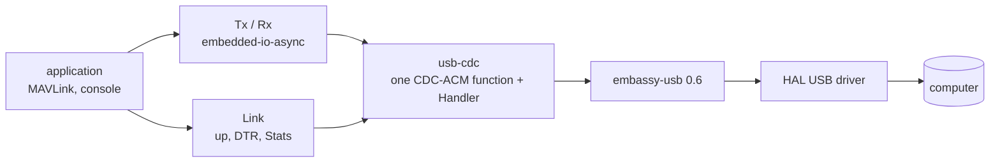

# usb-cdc

USB CDC-ACM byte pipe and link state on `embassy-usb` 0.6, written for the MARV V2 Rev 1 flight controller. The crate is `no_std`. It
adds one CDC-ACM function and one handler to the firmware's `embassy_usb::Builder` and gives back `Tx` (`embedded_io_async::Write`), `Rx`
(`embedded_io_async::Read`) and `Link` (up or down, DTR, counters). It moves bytes and knows nothing about what they mean: a protocol
layer such as MAVLink sits on top, never inside.



## Usage

The firmware side (`ignore`d here because it needs a HAL driver):

```rust,ignore
use embedded_io_async::{Read, Write};

let mut builder = embassy_usb::Builder::new(driver, usb_config, /* descriptor and control buffers */);
// The firmware's identity is in `usb_config`; this crate has none.
static STATE: StaticCell<usb_cdc::State<'static>> = StaticCell::new();
let cdc = usb_cdc::UsbCdc::new(&mut builder, STATE.init(usb_cdc::State::new()), usb_cdc::Config::new());
let (mut tx, mut rx, link) = cdc.split();
let mut usb = builder.build();
spawner.spawn(usb_task(usb)).unwrap(); // `usb.run().await`, never cancelled

loop {
    link.wait_up().await;
    let mut buf = [0u8; 64];
    // `Err(NotConnected)` comes at once when the cable is gone, also from a call that was waiting.
    while let Ok(n) = rx.read(&mut buf).await {
        if tx.write_all(&buf[..n]).await.is_err() { break; }
    }
}
```

Works on any chip with an `embassy-usb` driver, with any executor. It does not work on the `usb-device` stack and has no blocking
front-end. Dependencies: `embassy-usb` 0.6 (no default features), `embassy-sync` 0.8, `embedded-io-async` 0.7, optionally `defmt`; the
application supplies a `critical-section` implementation.

## Docs

| Page | Contents |
|---|---|
| [docs/device.md](docs/device.md) | The three traps of the bare CDC class, what the handler hears, what "up" means |
| [docs/usage.md](docs/usage.md) | What the application provides, rules for correct use, what the crate does, limits |
| [docs/testing.md](docs/testing.md) | Host tests, the on-board programs, reference figures, features |
| [host/README.md](host/README.md) | The computer-side program that talks to the board |

## Status

- Version 0.1.0, `publish = false`; the API may still change.
- Host tests pass (34 tests, including property tests, against a fake driver and one real `UsbDevice::run()`).
- On the board (MARV V2 Rev 1 on a Linux computer): echo, throughput, port close/open cycles, soft detach, a computer that stops reading,
  interrupts-off time and one physical cable pull on a battery-powered board pass.
- Not verified: Windows and macOS; repeated pulls, a pull mid-enumeration, selective suspend; a link ended by the computer without
  root; several CDC functions on one builder; high speed; runs longer than a minute.

Used by: MARV-FC firmware.

## MARV project

| Repository | Role |
|---|---|
| [MARV-FC](https://github.com/Lmx154/MARV-FC) | Flight-controller firmware for the MARV V2 board (RP2350B) |
| [MARV-GCS](https://github.com/Lmx154/MARV-GCS) | Ground station (`marv-gcs`) and command line (`marv-cli`) |
| [MARV-sim](https://github.com/Lmx154/MARV-sim) | Simulator that runs the firmware's flight code |
| Sensors | [icm45686](https://github.com/Lmx154/icm45686-rs) · [lsm6dsk320x](https://github.com/Lmx154/lsm6dsk320x-rs) · [bmp581](https://github.com/Lmx154/bmp581-rs) · [bmm350](https://github.com/Lmx154/bmm350-rs) · [sam-m10q](https://github.com/Lmx154/sam-m10q) · [adc-battery](https://github.com/Lmx154/adc-battery) |
| Board I/O | [pio-sdmmc](https://github.com/Lmx154/pio-sdmmc-rs) · [qmi-psram](https://github.com/Lmx154/qmi-psram-rs) · [ws2812c](https://github.com/Lmx154/ws2812c-rs) · **usb-cdc** · [pio-uart](https://github.com/Lmx154/pio-uart) |
| Motors and links | [dshot](https://github.com/Lmx154/dshot-rs) · [esc-passthrough](https://github.com/Lmx154/esc-passthrough) · [rc-port](https://github.com/Lmx154/rc-port) · [crsf-codec](https://github.com/Lmx154/crsf-codec) · [mavlink-device](https://github.com/Lmx154/mavlink-device) · [marv-dialect](https://github.com/Lmx154/marv-dialect) |
| Other drivers | [lc76g](https://github.com/Lmx154/lc76g-rs) (Quectel LC76G GNSS) |

## Licence

MIT, see `LICENSE`.
