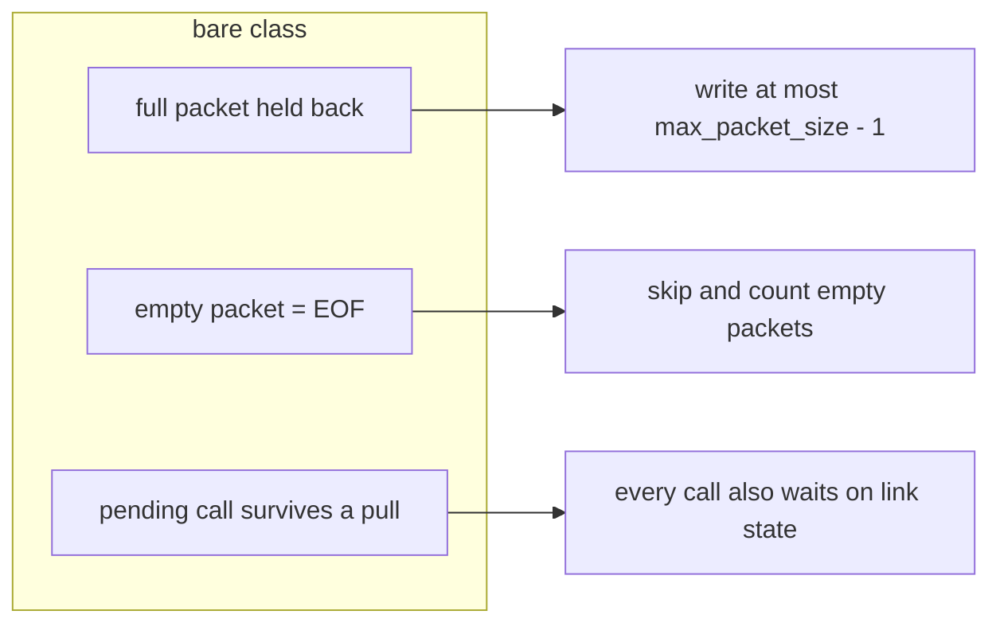

# The bare CDC class and what this crate changes

Part of [usb-cdc](../README.md)

`embassy-usb` 0.6.0's CDC-ACM class and `embassy-rp` 0.10.0's USB driver have three behaviours that make a byte pipe unreliable. This
page names them with file and line in those crates (`EU` = embassy-usb, `ERP` = embassy-rp) and says how usb-cdc answers each.

## The three traps

| # | Trap | Source | usb-cdc answer |
|---|---|---|---|
| 1 | A full-size IN packet is held back by the host until a shorter one follows, and `flush` does nothing. `Sender::write` sends `min(len, max_packet_size)` bytes, so a 64-byte write is a full packet and nothing sends the zero-length packet that would end it | `EU/src/class/cdc_acm.rs:90-93`, `:451-463` | `Tx::write` sends at most `max_packet_size - 1` bytes; no zero-length packet is ever needed |
| 2 | A zero-length packet from the computer reads as `Ok(0)`, which `embedded-io-async` defines as end of file for a non-empty buffer; `read_exact` and most framing code stop there | `BufferedReceiver::read`, `cdc_acm.rs:576-604`, `:542-548`, `:585-591` | `Rx::read` skips and counts empty packets, and never returns `Ok(0)` for a non-empty buffer |
| 3 | A pending endpoint call does not end when the cable goes. The futures wait in a `poll_fn` that only looks at the buffer's `available` bit; a bus reset clears `buff_status` but leaves `available`, so a write in flight stays pending until the next enumeration. The reset wakes every endpoint waker but the futures find the same state. The class does not report it either: `Handler::configured(false)` is not called on a reset | `ERP/src/usb.rs:571-590`, `:614-640`, `:393-412`; `EU/src/lib.rs:447-457` | Every `read` and `write` also waits on the link state, and the crate's handler wakes it |

## What the handler hears

The crate registers one `embassy_usb::Handler` with `Builder::handler` (`EU/src/builder.rs:275`; at most `max_handler_count`, default 4,
the CDC class uses one). Up means configured and not suspended.

| Call | Source | Link |
|---|---|---|
| `enabled(true / false)` | `EU/src/lib.rs:486`, `:307`, `:495` | down |
| `reset()` | `lib.rs:455` | down, suspend cleared, `Stats::resets` + 1 |
| `addressed(addr)` | `lib.rs:526` | ignored (a reset already made the link down) |
| `configured(true / false)` | `lib.rs:544`, `:562` | up / down (unless suspended) |
| `suspended(true / false)` | `lib.rs:477`, `:470`, `:336` | down / up again if configured |

Every change of up counts in `Stats` and wakes every waiting future. A connection counter changes each time the link comes up, so a call that
began in one connection ends with `NotConnected` even if the link went down and up again before the call was polled.

## Shared state

The link state sits in the crate's `State` behind `embassy_sync::blocking_mutex::CriticalSectionMutex`, as the CDC class's own control
state does (`cdc_acm.rs:108-115`): the handler runs in the task of `UsbDevice::run()`, the futures in the link task, possibly on another
executor or core. The crate has no `critical_section::with` call or atomic of its own; the lock is held for a few instructions per poll.

## How the RP2350 controller reports events

| Event | What the crate sees |
|---|---|
| Soft detach (D+ pull-up released) while configured | `reset()` about 100 us later (98-116 us) and nothing else until the pull-up returns; a pending `Tx::write` returns `NotConnected` 161-234 us after the release. After the pull-up returns: `suspended(true)` 3 ms later, `reset()` twice, `addressed`, `configured(true)` about 345 ms after the pull-up. Per soft detach `Stats` counts one down, one up, three resets (sometimes four), one suspend |
| Cable pulled on a powered board | The controller has no VBUS detection in embassy-rp, so the pull is a bus suspend only: `suspended(true)` about 3.2 ms after the last good write, the pending write returns `NotConnected` 38 us later. With the cable back: two resets, `configured(true)` 240 ms after the first |
| Computer closes the port | Nothing on the link; DTR goes false on close and true on open |
| Computer stops reading | `Tx::write` completes when the endpoint takes the packet (about 5 KB accepted, 81 records of 63 bytes), then every `write_all` waits for its timeout; the computer delivers the packet held in the endpoint when the port is opened again |
| Bytes from the old connection | Bytes the computer sent that sat unread in the OUT endpoint at a detach never reached the device after the reset; `Rx` also drops a packet it holds when the session changes |

## Related

- [usage](usage.md): the rules that follow from this
- [testing](testing.md): the checks behind these figures
