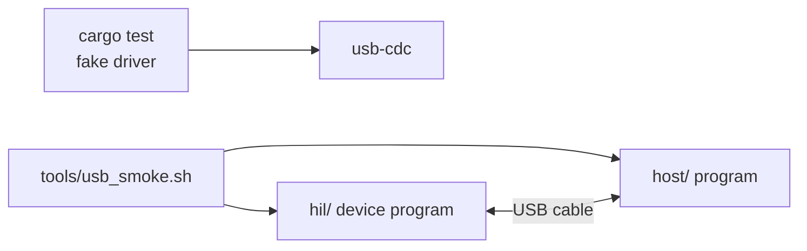

# Testing

Part of [usb-cdc](../README.md)

The crate is tested on the host against a fake USB driver, and on the board with device programs in `hil/` paired with the computer-side
[host](../host/README.md) program.

## Host

`cargo test --features _test-hooks` runs 34 tests (plain `cargo test` also works; a dev-dependency turns the feature on). The tests build a
real `embassy_usb::Builder` on a fake driver (`tests/fake/mod.rs`: endpoints the test feeds, watches and makes pending). Three are
property tests: IN packets of 1 to 63 bytes unchanged for writes of 0 to 4096 bytes, the same for packet sizes 8 to 64, and `read` never
giving `Ok(0)` or losing a byte over random packets and buffer sizes. One test polls a real `UsbDevice::run()` against a scripted bus, so
handler registration and DTR are tested through the real device; the others call the same `Handler` methods through `Link::inject`.

Build checks: `cargo build --target thumbv8m.main-none-eabihf` (also `--features defmt`), `cargo clippy --all-targets --features
_test-hooks -- -D warnings`, `cargo fmt -- --check`, `cargo tree -e normal` (no `mavlink`, `embassy-rp` or `embassy-executor`).

## On the board

`tools/usb_smoke.sh smoke|fullpacket|link|unplug` builds and flashes (through `tools/run.sh` only) one `hil/` program, then runs it
together with the matching host subcommand. Test identity: VID 0xc0de, PID 0xcafe, "MARV", "usb-cdc test", "usb-cdc-hil".

| Program | What it checks |
|---|---|
| `alive` | The crate links for the board |
| `usb_cdc_smoke` | 17 checks: enumeration, echo in awkward sizes, throughput, bursts |
| `usb_cdc_fullpacket` | Positive control on the bare class: a lone full 64-byte packet is held back by the computer until more data follows |
| `usb_cdc_link` | Link behaviour, checks A to E below |
| `usb_cdc_unplug` | A physical cable pull on a battery-powered board (needs a person at the board; the host program reports `[SKIP]` on USB power, where the pull switches the board off) |

## Reference figures

Board: MARV V2 Rev 1 (RP2354B, 150 MHz) cabled to a Linux computer (`cdc_acm`, `serialport` 4.x). Windows and macOS were not run.

| Figure | Value |
|---|---|
| Link up after the pull-up | about 345 ms |
| Bus before first configuration | Linux resets the bus twice and it idles once |
| DTR after link-up | true 17-56 ms after the link came up, when the computer opened the port |
| Echo 1 MiB in awkward sizes (63, 64, 65, 128, 4096, random) | 0 errors, 319 kB/s each way |
| Device to computer, 4 MiB | 757 kB/s |
| Computer to device, 1 MiB | 639 kB/s |
| Bursts of 64 / 128 / 4096 bytes | complete within 0.1 / 0.2 / 5.4 ms |
| Lone full packet on the bare class | held back until more data follows (10 of 10); 128 and 4096 bytes arrive promptly |

`usb_cdc_link` checks:

| Check | Result |
|---|---|
| A. Computer keeps the port open without reading for 10 s, then closes it for 10 s (1 kHz tick task, link task, writer of numbered 63-byte records with a 100 ms `write_all` timeout) | Tick task: no period over 1.5 ms (largest 1.27 ms). Writer: 81 records accepted then every `write_all` times out at 100.005-100.012 ms, no other error. Records the computer received are whole with a right checksum and increasing sequence. A completed `Tx::write` means the endpoint took the packet, not that the computer has it. `FIONREAD` reads 4095 (tty buffer limit) |
| B. 20 cycles of close, 200 ms, open, echo 64 KiB | 0 mismatched, missing or extra bytes; `Stats` unchanged (closing the port does not touch the link); `dtr()` true after every open |
| C. Soft detach with a `Tx::write` pending, 10 times | The write returns `Err(NotConnected)` 161-234 us after the release (limit 50 ms); after 500 ms the link returns and an echo of 4 KiB passes; no byte of the old connection in either direction. Control without detach shows the unread bytes do reach the device when the link stays up |
| D. Computer makes the link go away without a person | Not possible without root (`USBDEVFS_RESET` and sysfs are not writable); the device side (`CYCLE 1`) and host ioctl exist but are unrun |
| E. Longest gap between SysTick interrupts (every 2 us, highest priority; an upper bound on masked time) | Idle 7.5-15.6 us; echo running 8.7-15.8 us; link flapping 17.5-23.3 us. `Link::is_up()` costs 91-93 cycles (0.6 us), `Link::stats()` 113-115. The crate's own sections cannot be separated from embassy-usb's and the HAL's |

Cable pull (`usb_cdc_unplug`): the pending `Tx::write` returned `NotConnected` 3246 us after the last good write. In the new connection the
start marker came with 0 bytes before it and an echo of 4 KiB passed. The last record the device counted as written never reached the
reading program: completion means the controller took the packet.

## Run the pull test

`tools/usb_smoke.sh unplug` builds, flashes and starts the device program, then prints "PULL THE BOARD'S USB CABLE NOW" (pull only the
board's own cable, not the debug probe's) and "PUT THE BOARD'S USB CABLE BACK NOW" once it saw the port go away. It reports the time from
the last good write to `NotConnected`, the `Handler` calls with their times, and whether an echo of 4 KiB passes in the new connection.

## Cargo features

| Feature | Default | Effect |
|---|---|---|
| `defmt` | off | `defmt::Format` on `Error`, `Stats`, `Config`; enables `defmt` in `embassy-usb`, `embassy-sync`, `embedded-io-async` |
| `_test-hooks` | off | `Link::inject` and `Event`, to drive the link state from host tests. Not for production |

## Related

- [usage](usage.md): the rules under test
- [device](device.md): the controller behaviour behind the figures
