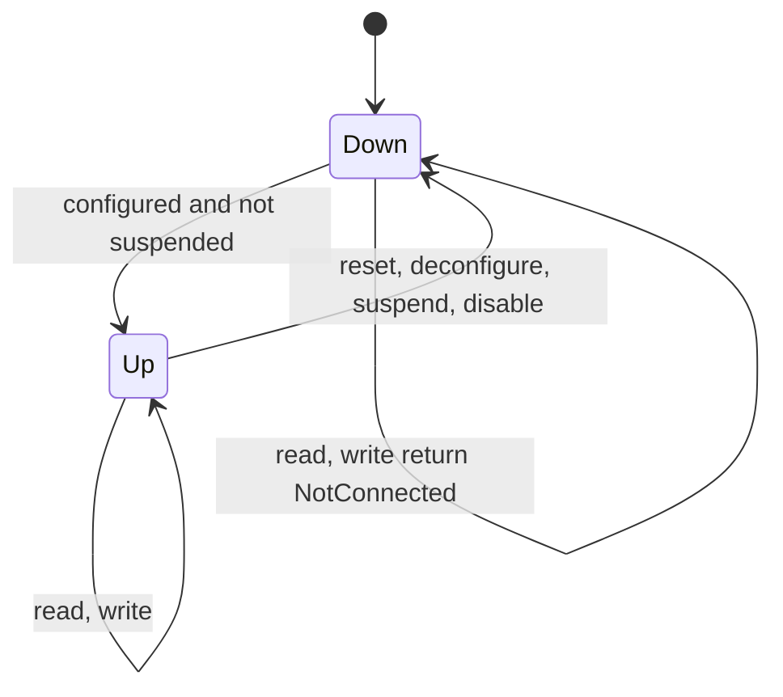

# Using usb-cdc

Part of [usb-cdc](../README.md)

`UsbCdc::new` adds the CDC function to a builder and `split()` returns `Tx`, `Rx` and `Link`. This page lists what the application must
provide and the rules for correct use.

## What the application provides

| Item | Rule |
|---|---|
| `embassy_usb::Builder` | With its own VID/PID, strings and power. Leave `device_class`, `device_sub_class`, `device_protocol` at the `Config::new` defaults (0xEF, 0x02, 0x01): the function is added with an interface association descriptor and `Builder::new` panics for any other class while `composite_with_iads` is true (`embassy-usb` 0.6.0 `builder.rs:176-182`) |
| Order and slots | Call `UsbCdc::new` before `builder.build()`; keep one handler slot free (`max_handler_count`, default 4; the CDC class uses one, this crate one) |
| `State` | Lives as long as the device |
| A task running `UsbDevice::run()` | Never cancelled (a dropped `run()` can leave the bus in an invalid state) |
| The task that awaits `Tx`, `Rx`, `Link` | Only that task should wait on them: a `write` waits while the computer is not reading |
| Timeouts | The crate has no timer |
| `critical-section` | An implementation |

## Rules for correct use

| Topic | Rule |
|---|---|
| Panics | None in the crate: `src/lib.rs` denies `unwrap_used`, `expect_used`, `panic`, `unreachable`, `todo`, `unimplemented`, `indexing_slicing` outside tests, and `forbid(unsafe_code)`. The one panic path is inside `embassy-usb`: `Builder::handler` asserts a free slot |
| `write` | Takes at most `max_packet_size - 1` bytes (63 by default). Use `write_all` for more; do not expect one `write` per message |
| `read` | Returns at least one byte or an error, never `Ok(0)` for a non-empty buffer. A zero-length buffer returns `Ok(0)`, or `Err` while the link is down |
| `NotConnected` | The only error. While the link is down every `read`, `write`, `flush` returns it at once; a call waiting when the link goes down returns it too, also if the link is back before the call is polled |
| Dropped futures | A dropped `write` has sent nothing or one whole packet. A dropped `read` loses no byte the crate holds. Tested at every await point |
| Link down | A partly read packet is thrown away, so bytes of the last connection never mix with the next |
| DTR | Reported by `Link::dtr`, never gates data; false after a bus reset |
| First write after link-up | Hold it until DTR has held for 100 ms (read `Link::dtr` at most every 5 ms) or the peer has spoken, whichever is first; keep reading meanwhile. After an enumeration the computer gives the port cooked terminal settings and its driver starts reading inside `open()` about 1 ms before the program can set raw mode (measured on Linux with `cdc_acm`: 0.31-0.35 ms after DTR rises), so bytes in that window are edited, dropped or echoed. The crate cannot see it. A later open in the same enumeration finds the port raw, so the hold is needed once per link-up. DTR alone stays silent for a host that never raises it, the peer alone for a program that only listens, hence both |
| Threads | `Tx`, `Rx`, `Link` are not `Send` (embassy-usb class types borrow a `RefCell`): never use them from two cores. Tasks on different executors of one core are fine |
| `max_packet_size` | 8, 16, 32 or 64 (`Config::with_max_packet_size`); another value is silently rounded down |

## What the crate does

- Keeps the link state from its own `Handler`. `Link::wait_up` and `wait_down` complete on the transition, or at once if already there.
  `Link::stats` counts ups, downs, resets, suspends and skipped zero-length packets (saturating `u32`).
- `Tx::write` sends one packet per call; `flush` does nothing.
- `Rx::read` serves a received packet over as many calls as needed and skips and counts zero-length packets.
- Has no `static`, queue, task, timer, spin loop or `critical_section::with` of its own.

## Not covered

High speed, isochronous and interrupt endpoints of the class (the notification endpoint is allocated and never used), line coding and RTS
(read them from the class if needed), remote wakeup, several CDC functions on one builder, `addressed`. `Link` is neither `Send` nor `Sync`.

## Code

| File | Contents |
|---|---|
| `src/lib.rs` | `State`, `Config`, `UsbCdc`, `Link` |
| `src/pipe.rs` | `Tx`, `Rx`, `Error` |
| `src/shared.rs` | Link state, handler, `Stats` |

## Related

- [device](device.md): why each rule exists
- [testing](testing.md): how they are checked
