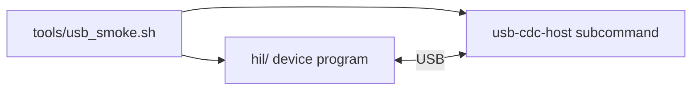

# host

Part of [usb-cdc](../README.md)

`usb-cdc-host` is the computer-side program of the on-board tests. It opens the board's CDC port with `serialport`, finds it by VID and
PID, and runs the host half of each test: echo and throughput for `smoke`, the held-back-packet control for `fullpacket`, the port
close/open, non-reading and soft-detach checks for `link`, and the cable-pull prompts for `unplug`.



## Run

```text
tools/usb_smoke.sh smoke|fullpacket|link|unplug
```

The script flashes the device program (through `tools/run.sh`) and starts this program alongside it. The exit status of both is the
verdict. The host program is its own Cargo package and is not part of the driver crate.

## Related

- [Testing](../docs/testing.md): what each program checks and the reference figures
